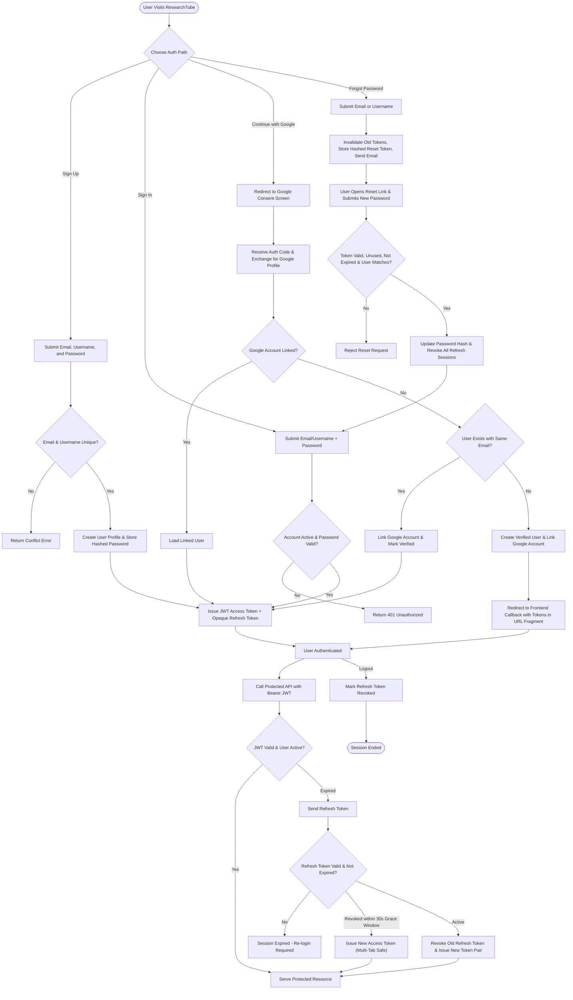
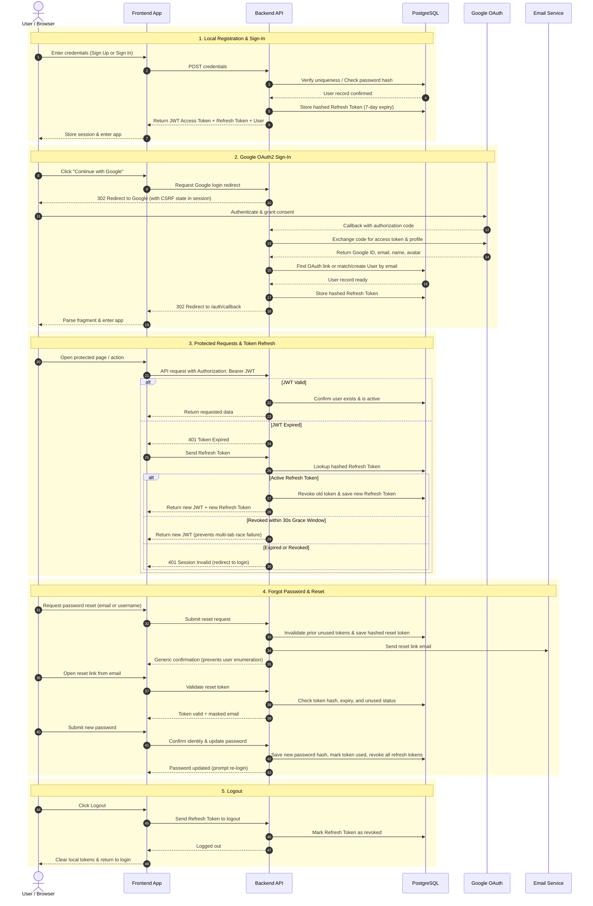
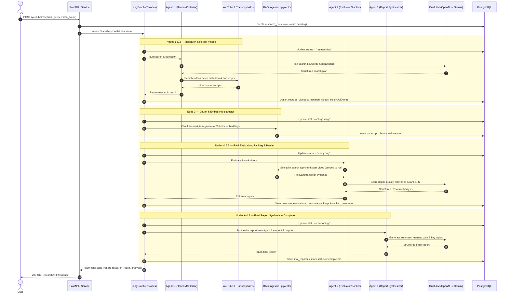
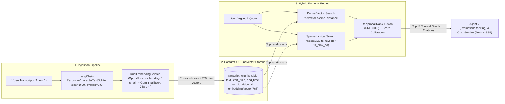
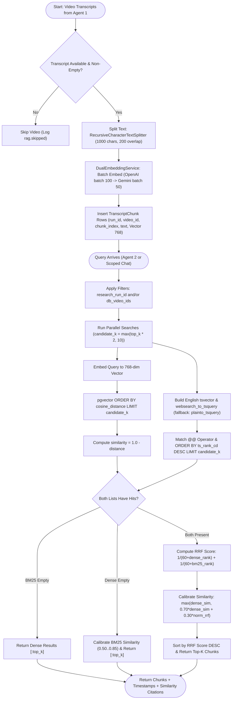

# ResearchTube: Complete System Architecture & Technical Specifications

> **ResearchTube** is an enterprise-grade, multi-agent AI research pipeline that converts raw YouTube video streams into structured, publication-ready technical intelligence reports. It leverages a **7-node LangGraph Directed Acyclic Graph (DAG)** state machine, **PostgreSQL pgvector RAG** semantic retrieval, a **3-layer proxy-resilient transcript scraper**, and a modern **React 19 + FastAPI** architecture.


## 1. HIGH LEVEL SYSTEM DESIGN


## 2. Auth Service





## 3. YouTube Research Service

`POST /youtube/research` creates a `research_runs` record and executes a **7-node linear LangGraph `StateGraph`** orchestrated by `YoutubeResearchService`:

1. **Node 1 — Agent 1 (Search & Collect):** Plans search parameters via DualLLM (OpenAI primary, Gemini fallback), queries YouTube Data API for videos/metadata, and fetches transcripts.
2. **Node 2 — Persist Research:** Upserts videos (`youtube_videos`, `research_videos`) and maps YouTube IDs to DB UUIDs.
3. **Node 3 — RAG Ingestion:** Chunks transcripts, generates 768-dim embeddings (OpenAI primary, Gemini fallback), and stores vectors in `pgvector` (`transcript_chunks`).
4. **Node 4 — Agent 2 (RAG Analysis & Ranking):** Runs `pgvector` similarity search per video (scoped to `research_run_id`), evaluates quality/depth/relevance via DualLLM, and ranks videos `1..N`.
5. **Node 5 — Persist Analysis:** Saves `resource_evaluations`, `resource_rankings`, and `ranked_resources`.
6. **Node 6 — Agent 3 (Final Report Synthesis):** Merges Agent 1 metadata + Agent 2 rankings (preserving scores) via DualLLM to generate the executive summary, learning path, and key topics.
7. **Node 7 — Persist Final Report:** Saves `final_reports` and marks the run `"completed"` (or `"failed"` on error).





## 4. Chat Service

```mermiad
sequenceDiagram
    autonumber
    actor User as Client (React + SSE)
    participant API as FastAPI Chat Routes
    participant CS as Chat Service Facade
    participant DB as PostgreSQL + pgvector
    participant Web as DuckDuckGo & Firecrawl
    participant LLM as DualLLM (OpenAI -> Gemini)
    participant E2B as E2B Cloud Micro-VM

    %% ========================================================
    %% 1. SESSION MANAGEMENT & SCOPING
    %% ========================================================
    rect rgba(255, 241, 118, 0.25)
        Note over User, DB: 1. Session Lifecycle (SessionService & GreetingService)
        User->>API: Create / List / Get / Pin / Archive / Update Scope / Delete Session
        API->>CS: Forward authenticated user_id + payload
        CS->>DB: Validate video/run ownership (if scoped) & mutate chat_sessions
        DB-->>CS: Session metadata & message history
        CS-->>User: Return ChatSessionResponse / DetailResponse
    end

    %% ========================================================
    %% 2. MESSAGING & STREAMING (ALL CASES)
    %% ========================================================
    rect rgba(255, 241, 118, 0.25)
        Note over User, E2B: 2. Send Message (SSE Stream / REST) — Scoping, RAG, Web, Tools & Cancel
        User->>API: POST /chat/sessions/{id}/messages/stream (message, scope, web_search)
        API->>CS: Start async SSE generator

        %% Validation & Atomic Scope Switch
        CS->>DB: Verify session ownership
        opt Atomic Scope Switch or Auto-Unarchive
            CS->>DB: Update scope_mode (none | video | all), video_id, is_archived=false
        end
        CS->>DB: Persist User ChatMessage
        CS-->>User: SSE event: user (saved user message)

        %% Parallel Context Gathering
        par Load History & Scope
            CS->>DB: Fetch recent conversation turns & scope description
        and Scoped RAG Retrieval
            alt scope_mode == "none"
                CS->>CS: Bypass pgvector search (empty context)
            else scope_mode == "video"
                CS->>DB: pgvector similarity search filtered by video_id (+ run_id)
            else scope_mode == "all"
                CS->>DB: pgvector similarity search across all user library videos
            end
        end
        DB-->>CS: History + top-k transcript chunks + source citations

        %% Dual-Mode Web Search
        opt Web Search Enabled OR Live-Query Keywords Detected
            CS-->>User: SSE event: status ("searching")
            CS->>Web: Search live web (top 5 results)
            Web-->>CS: Clean web sources (appended to citations)
            CS-->>User: SSE event: status ("scraping")
            CS->>Web: Scrape top 3 pages (Firecrawl / HTML)
            Web-->>CS: Scraped page content
        end

        %% LLM Streaming + Autonomous Sandbox Loop
        CS->>LLM: Stream prompt (RAG chunks + history + web context) with Python/C++ tools

        alt Case A: Direct Text Response (No Tool Calls)
            loop Token Stream
                LLM-->>CS: Text chunk
                CS-->>User: SSE event: delta ({"text": ...})
            end
        else Case B: Autonomous Code Sandbox Execution (up to 2 tool turns)
            LLM-->>CS: Tool call (execute_python_code or execute_cpp_code)
            CS-->>User: SSE event: status ("executing_code")
            CS->>E2B: Run Python / compile & run C++ in isolated micro-VM
            E2B-->>CS: stdout, stderr, base64 plots, file artifacts (PDF/CSV)
            CS-->>User: SSE event: status ("code_executed", duration, counts)
            CS-->>User: SSE event: status ("generating")
            CS->>LLM: Send ToolMessage results to synthesize final answer
            loop Synthesized Stream
                LLM-->>CS: Text token
                CS-->>User: SSE event: delta ({"text": ...})
            end
            opt Plots or File Artifacts Generated
                CS-->>User: SSE event: delta (Markdown charts & download links)
            end
        end

        %% Cancellation vs Completion
        alt Client Disconnected / Cancelled Mid-Stream
            CS->>DB: Delete persisted user message (clean rollback)
            CS-->>User: Abort stream
        else Stream Completed Normally
            CS->>DB: Persist Assistant ChatMessage (content + JSON sources) & increment message_count (+2)
            CS-->>User: SSE event: done (message_id, sources, sandbox_executed, counts)
        else Runtime Exception
            CS-->>User: SSE event: error ({"detail": ...})
        end
    end

    %% ========================================================
    %% 3. PUBLIC SHARING & FORKING
    %% ========================================================
    rect rgba(255, 241, 118, 0.25)
        Note over User, DB: 3. Sharing & Conversation Forking (ShareService)
        User->>API: POST /chat/sessions/{id}/share (or DELETE to revoke)
        API->>CS: Generate/activate share_token (or set is_shared=false)
        CS->>DB: Update chat_sessions
        CS-->>User: Return share_url (/share/chat/{token})

        User->>API: GET /chat/shared/{share_token} (Public, no auth)
        API->>CS: Lookup token (exact -> case-insensitive -> OCR 7/Z mistype tolerance)
        CS->>DB: Fetch shared session + messages
        CS-->>User: Return PublicSharedChatResponse

        User->>API: POST /chat/shared/{share_token}/fork (Authenticated)
        API->>CS: Clone shared session & all messages for current user
        CS->>DB: Insert new ChatSession + copied ChatMessages
        CS-->>User: Return ForkChatResponse (new session_id)
    end
```


## 5. RAG Architecture

### RAG Architecture Diagram




### End-to-End Ingestion & Hybrid Retrieval



### In-Depth Technical Details

#### Ingestion & pgvector Storage

1. **Transcript Filtering:** Videos without transcripts (`transcript_available=False`) or empty text are skipped cleanly.
2. **Semantic-Aware Chunking (`TextChunker`):** Uses LangChain's `RecursiveCharacterTextSplitter` (`chunk_size=1000`, `chunk_overlap=200`) with separator priority `["\n\n", "\n", " ", ""]` so sentences and paragraphs aren't sliced mid-word.
3. **Dual-Provider 768-dim Embeddings (`DualEmbeddingService`):**
   - **Primary:** OpenAI `text-embedding-3-small` with native dimensionality reduction to **768**, processed in batches of **100**.
   - **Fallback:** Google Gemini `gemini-embedding-001` (`output_dimensionality=768`), processed in batches of **50** if OpenAI fails or is unconfigured.
4. **PostgreSQL Storage (`transcript_chunks`):** Each chunk is stored with `research_run_id`, `video_id`, `chunk_index`, `text`, `language`, `start_time`, `end_time`, and `embedding Vector(768)`, enforced by unique constraint `uq_run_video_chunk` and composite index `ix_transcript_run_video_chunk`.

#### Hybrid Retrieval & Reciprocal Rank Fusion 

1. **Why Hybrid?**
   - **Dense Vector Search** understands paraphrasing and broad concepts.
   - **Sparse Lexical Search (BM25/FTS)** catches exact terms that embeddings often blur (CLI flags, library names, error codes, function names).
2. **Concurrent Candidate Fetching (`candidate_k = max(top_k * 2, 10)`):**
   - `dense_search`: Embeds the query → orders by `TranscriptChunk.embedding.cosine_distance(query_embedding)` → `similarity = 1.0 - distance`.
   - `bm25_search`: Uses PostgreSQL native Full-Text Search `to_tsvector('english', text) @@ websearch_to_tsquery('english', query)` (with automatic fallback to `plainto_tsquery` for tricky punctuation) → ranks by **`ts_rank_cd`** (Cover Density ranking).
   - Both queries are strictly scoped by `research_run_id` and/or `db_video_ids` to prevent cross-run or cross-user leakage.
3. **Reciprocal Rank Fusion (RRF, `k = 60`):**
   - Combines both ranked lists without needing raw score normalization:
     $$\text{RRF\_score}(d) = \frac{1}{60 + \text{dense\_rank}(d)} + \frac{1}{60 + \text{bm25\_rank}(d)}$$
4. **Score Calibration & Zero-Regression Fallbacks:**
   - Downstream filters (e.g., `min_similarity >= 0.40` in Chat) expect a `[0.0, 1.0]` similarity score, so RRF calibrates:
     - **Hybrid / Dense hit:** `max(dense_sim, 0.70 * dense_sim + 0.30 * norm_rrf)`
     - **BM25-only hit:** `0.50 + 0.35 * (1.0 - (bm25_rank - 1) / candidate_k)`
   - If `hybrid_search` fails for any reason, `similarity_search` seamlessly falls back to pure `dense_search`.