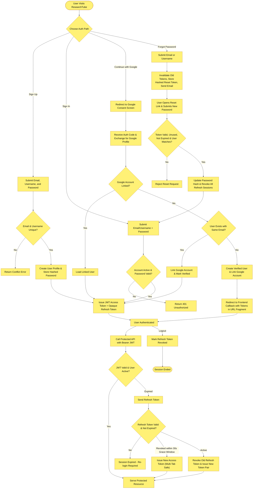

# ResearchTube: Complete System Architecture & Technical Specifications

> **ResearchTube** is an enterprise-grade, multi-agent AI research pipeline that converts raw YouTube video streams into structured, publication-ready technical intelligence reports. It leverages a **7-node LangGraph Directed Acyclic Graph (DAG)** state machine, **PostgreSQL pgvector RAG** semantic retrieval, a **3-layer proxy-resilient transcript scraper**, and a modern **React 19 + FastAPI** architecture.


## 1. HIGH LEVEL SYSTEM DESIGN


## 2. Auth Service




## 6. Frontend Architecture & Component Hierarchy

The frontend is structured modularly with clear separation of UI pages, state context, and layout components:

```text
frontend/src/
├── api/
│   ├── client.ts          # Axios instance with JWT interceptors & token refresh
│   ├── auth.ts            # Auth requests & localStorage session persistence
│   └── research.ts        # Research pipeline API calls & history queries
├── components/
│   ├── Button.tsx         # Primary & Secondary button design system
│   ├── Input.tsx          # Form inputs with helper text & validation
│   ├── Navbar.tsx          # Main header navigation bar
│   ├── Sidebar.tsx         # Collapsible sidebar with active tab glow
│   ├── UserMenu.tsx       # Profile menu & logout trigger
│   └── KnowledgeGraph.tsx # D3 / SVG 2D Knowledge Graph Visualizer
├── context/
│   └── AuthContext.tsx    # Auth state, login/register/logout, full-screen loading screen
├── layouts/
│   └── AppLayout.tsx      # Authenticated dashboard wrapper with route key animation
└── pages/
    ├── Landing.tsx        # Public landing page with live interactive pipeline demo
    ├── Research.tsx       # Research dashboard, search bar, history drawer, ReportView
    ├── Profile.tsx        # Profile management, security, and Research Analytics stats
    ├── Library.tsx        # Feature showcase library
    ├── About.tsx          # Project architecture & mission
    ├── Login.tsx          # Sign-in page with Google OAuth button
    ├── Register.tsx       # Account creation page
    └── SharedReport.tsx   # Public share view for research reports
```