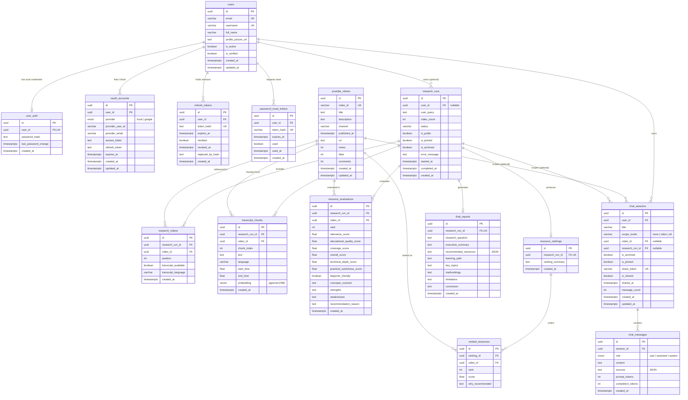

# ResearchTube: Database Design & Schema Documentation

> **ResearchTube** uses **PostgreSQL 16** with the **`pgvector`** extension, accessed asynchronously via **SQLAlchemy 2.0 (`asyncpg`)** and managed with **Alembic** across both local development (Docker PostgreSQL) and production (Supabase PostgreSQL with Supavisor pooler).

---

## 1. Overview & Stack

| Component | Technology / Configuration |
| :--- | :--- |
| **Database Engine** | PostgreSQL 16 + `pgvector` (`Vector(768)`) |
| **ORM & Driver** | SQLAlchemy 2.0 Async (`postgresql+asyncpg`) |
| **Migrations** | Alembic (`-x env=dev` / `-x env=prod`) |
| **Prod Pooler Support** | Supavisor Transaction/Session Pooler (`statement_cache_size=0` on port `6543`) |
| **Total Tables** | **15** (5 Auth/User, 8 YouTube Research & RAG, 2 Chat) |

---

## 2. Entity-Relationship Diagram (ER Diagram)

---

## 3. Domain Tables Breakdown

### A. User & Authentication Domain (`auth.py`, `user.py`)

| Table | Purpose | Key Columns & Constraints |
| :--- | :--- | :--- |
| **`users`** | Core user identity, decoupled from auth methods so local and OAuth logins share one account. | `id` (PK), `email` (UK, indexed), `username` (UK), `is_active`, `is_verified` |
| **`user_auth`** | Local email/password credentials (`1:1` with `users`). | `user_id` (FK → `users.id`, UK), `password_hash`, `last_password_change` |
| **`oauth_accounts`** | Linked external OAuth providers (e.g., Google). | `user_id` (FK), `provider` (`local \| google`), `provider_user_id`; Unique `uq_oauth_provider_user(provider, provider_user_id)` |
| **`refresh_tokens`** | Opaque session refresh tokens stored as SHA-256 hashes with rotation support. | `user_id` (FK), `token_hash` (UK), `expires_at`, `revoked`, `revoked_at`, `replaced_by_hash` |
| **`password_reset_tokens`** | Single-use hashed tokens for self-service password resets. | `user_id` (FK), `token_hash` (UK, 64 chars), `expires_at`, `used`, `used_at` |

---

### B. YouTube Research & RAG Domain (`youtube.py`)

| Table | Purpose | Key Columns & Constraints |
| :--- | :--- | :--- |
| **`research_runs`** | Tracks a single multi-agent research request from `pending` → `completed` / `failed`. | `id` (PK), `user_id` (FK, nullable), `user_query`, `video_count`, `status`, `is_public`, `is_pinned`, `is_archived` |
| **`youtube_videos`** | Canonical YouTube video metadata, deduplicated across runs. | `id` (PK), `video_id` (UK, YouTube string ID), `title`, `channel`, `views`, `likes`, `comments`, `published_at` |
| **`research_videos`** | Join table linking a `research_run` to its collected `youtube_videos`. | `research_run_id` (FK), `video_id` (FK), `position`, `transcript_available`, `transcript_language`; Unique `uq_research_video` |
| **`transcript_chunks`** | Chunked transcripts + **768-dim `pgvector`** embeddings for Hybrid RAG (vector + FTS). | `research_run_id` (FK), `video_id` (FK), `chunk_index`, `text`, `start_time`, `end_time`, `embedding Vector(768)`; Unique `uq_run_video_chunk` |
| **`resource_evaluations`** | Agent 2's per-video scoring and qualitative analysis. | `research_run_id` (FK), `video_id` (FK), `rank`, `relevance_score`, `educational_quality_score`, `coverage_score`, `overall_score`, `beginner_friendly`; Unique `uq_evaluation_research_video` |
| **`resource_rankings`** | Global ranking summary produced by Agent 2 (`1:1` with `research_runs`). | `research_run_id` (FK, UK), `ranking_summary` |
| **`ranked_resources`** | Ordered list of ranked videos within a `resource_rankings` record. | `ranking_id` (FK), `video_id` (FK), `rank`, `score`, `why_recommended`; Unique `uq_ranked_resource_video`, Index `ix_ranked_resource_ranking_rank` |
| **`final_reports`** | Agent 3's synthesized report (`1:1` with `research_runs`). | `research_run_id` (FK, UK), `executive_summary`, `recommended_resources` (JSON), `learning_path`, `key_topics`, `methodology`, `limitations`, `conclusion` |

---

### C. Chat Domain (`chat.py`)

| Table | Purpose | Key Columns & Constraints |
| :--- | :--- | :--- |
| **`chat_sessions`** | Persistent conversation threads with optional RAG scoping and public sharing. | `id` (PK), `user_id` (FK), `scope_mode` (`none \| video \| all`), `video_id` (FK, `SET NULL`), `research_run_id` (FK, `SET NULL`), `is_pinned`, `is_archived`, `share_token` (UK), `is_shared`, `message_count` |
| **`chat_messages`** | Individual conversation turns (`user`, `assistant`, `system`) with RAG/web citations. | `id` (PK), `session_id` (FK), `role`, `content`, `sources` (JSON), `prompt_tokens`, `completion_tokens`, `created_at` |

---

## 4. Key Architectural Decisions

1. **Identity & Credential Separation:**
   - `users` stores profile state, while `user_auth` and `oauth_accounts` store credentials. If a local user later signs in with Google using the same email, the `oauth_accounts` row links directly to their existing `users` record without duplicating accounts.
2. **Run-Scoped RAG (`transcript_chunks`):**
   - `youtube_videos` is canonical (one row per YouTube `video_id`), whereas `transcript_chunks` is scoped by `(research_run_id, video_id, chunk_index)`. This prevents cross-run contamination when the same video is analyzed under different research queries.
   - Supports **Hybrid Retrieval** in PostgreSQL: dense cosine similarity on `Vector(768)` combined with native `tsvector` / `ts_rank_cd` full-text search via Reciprocal Rank Fusion (RRF).
3. **Token Security & Multi-Tab Rotation:**
   - Both `refresh_tokens` and `password_reset_tokens` store **SHA-256 hashes**, never raw tokens.
   - `refresh_tokens` tracks `revoked_at` and `replaced_by_hash` to support a 30-second rotation grace window so concurrent browser tabs don't log the user out.
4. **Cascade & Cleanup Integrity:**
   - Deleting a `User`, `ResearchRun`, or `ChatSession` cascades cleanly to all owned child records (`ondelete="CASCADE"`).
   - Deleting a `YouTubeVideo` or `ResearchRun` referenced by a `ChatSession` uses `ondelete="SET NULL"` so chat history is preserved even if the scoped video/run is removed.
