# ResearchTube Frontend Engine

Welcome to the client-side user interface of **ResearchTube** — a modern, responsive single-page web application (SPA) built using React 19, Vite, and TailwindCSS v4. 

The frontend allows users to sign up, log in, initiate complex multi-agent research runs, view detailed report summaries, interact with semantic knowledge graphs, and share public reports.

### Documentation & Architecture References (`../docs/`)

* **[Frontend Architecture Guide (docs/FRONTEND.md)](../docs/FRONTEND.md)** — Detailed frontend directory breakdown, rationale for every npm dependency, JWT 401 refresh queue, and SSE chat streaming workflows.
* **[System Architecture & HLD (docs/ARCHITECTURE.md)](../docs/ARCHITECTURE.md)** — Complete High-Level System Design ([`hld.png`](../docs/static/images/hld.png) / [`ResearchTube AI.excalidraw`](../docs/ResearchTube%20AI.excalidraw)), Auth Service, 7-node YouTube Research pipeline, Chat Service, and Hybrid RAG architecture.
* **[Database Design (docs/DATABASE-DESIGN.md)](../docs/DATABASE-DESIGN.md)** — Complete 15-table **PostgreSQL 16 + `pgvector`** schema and ER diagram.
* **[Backend Environment Setup (backend/ENV_SETUP.md)](../backend/ENV_SETUP.md)** — Required backend API keys, Google OAuth redirect setup, and `.env` configuration.

---

## 🏗️ Tech Stack & Dependencies

The application is structured as a TypeScript SPA leveraging the following libraries:

| Core Technology | Component / Library | Purpose in ResearchTube |
|---|---|---|
| **Core Framework** | `React 19` | Build component-based interactive interfaces using hooks and concurrent rendering features. |
| **Build Bundler** | `Vite 8` | Hot Module Replacement (HMR) for instant updates during development and fast production builds. |
| **Language** | `TypeScript 6` | Static typing for code reliability and self-documenting interface definitions. |
| **Styling** | `TailwindCSS v4` | Modern CSS engine utilizing Tailwind v4 with raw PostCSS support for custom components. |
| **Routing** | `React Router DOM 7` | Declarative client-side routing, protected routes, and callback navigation hooks. |
| **Networking** | `Axios` | Async HTTP client with request/response interceptors to attach bearer JWT headers automatically. |
| **Icons** | `Lucide React` | Sleek, modern outline SVG icon set for dashboards, stats, and sidebar items. |
| **Code Linting** | `Oxlint` | Ultra-fast Rust-based linter enforcing clean React code guidelines. |

---

## 📂 Project Architecture & Codebase Layout

The source directory [`src/`](file:///c:/Saket/Projects/ResearchTube/frontend/src) is separated by feature concern:

```
frontend/src/
│
├── api/                  # Async REST API wrappers (axios client)
│   ├── auth.ts           # Credentials sign-up/login & profile calls
│   ├── client.ts         # Axios client instance with auth interceptor
│   └── research.ts       # Runs retrieval, creation, public reports
│
├── components/           # Reusable UI widgets
│   ├── Button.tsx        # Styled theme action button
│   ├── Input.tsx         # Input field with form labels
│   ├── KnowledgeGraph.tsx # Zoomable, interactive 2D concept network graph
│   ├── Navbar.tsx        # Top status bar showing context details
│   ├── Onboarding.tsx    # First-use walkthrough tooltip modal
│   ├── ProtectedRoute.tsx# Router guard for authenticated paths
│   ├── Sidebar.tsx       # Navigation panel with pin/unpin animation
│   ├── Toast.tsx         # Notification feedback widget
│   └── UserMenu.tsx      # Avatar profile dropdown menu
│
├── context/              # Global React context providers
│   └── AuthContext.tsx   # Stores JWT, tracks user session state
│
├── layouts/              # Routing layouts
│   └── AppLayout.tsx     # App shell wrapper containing sidebar + content
│
├── pages/                # Distinct screen page components
│   ├── AuthCallback.tsx  # OAuth redirect receiver (extracts parameters)
│   ├── AuthTest.tsx      # Sandbox view for connection testing
│   ├── Dashboard.tsx     # Research execution control panel
│   ├── Landing.tsx       # Public homepage and platform features overview
│   ├── Login.tsx         # Credentials login page
│   ├── Profile.tsx       # Settings panel, research metrics and account deletion
│   ├── Register.tsx      # Credentials registration page
│   ├── Research.tsx      # Alternate dashboard routes
│   └── SharedReport.tsx  # Unauthenticated shared research reports renderer
│
└── routes/               # Routing mappings
    └── AppRoutes.tsx     # Defines URL mappings and Protected guards
```

---

## 🧭 Page Routes & View Mappings

The frontend uses client-side routing. Routes are divided into **Public (Unauthenticated)**, **OAuth Callbacks**, and **Protected (Authenticated)** categories.

### Mappings Table

| Route Path | Type | Component | Purpose |
|---|---|---|---|
| `/` | Public | `Landing.tsx` | Informational homepage with platform intro |
| `/login` | Public | `Login.tsx` | Local password login credentials form |
| `/register` | Public | `Register.tsx` | Local registration page |
| `/shared/:run_id` | Public | `SharedReport.tsx` | Viewer for shared public research reports |
| `/auth/callback` | OAuth | `AuthCallback.tsx` | Processes redirection tokens from Google OAuth |
| `/dashboard` | Protected | `Dashboard.tsx` | Initiates research and displays reports |
| `/profile` | Protected | `Profile.tsx` | User stats, password settings, account deletion |

---

## ⚡ Key Feature Implementation Details

### 1. Bearer JWT Authentication Flow
Auth is coordinated via the global [`AuthContext.tsx`](file:///c:/Saket/Projects/ResearchTube/frontend/src/context/AuthContext.tsx):
*   On login or registration, the server returns an `access_token` and `refresh_token`.
*   The tokens are stored in the user's `localStorage`.
*   An **Axios Interceptor** ([`client.ts`](file:///c:/Saket/Projects/ResearchTube/frontend/src/api/client.ts)) automatically intercepts every request and injects the `Authorization: Bearer <access_token>` header.
*   If an endpoint returns `401 Unauthorized`, the interceptor triggers a background token rotation request `/auth/refresh` using the stored `refresh_token`, updates the tokens, and retries the original request seamlessly.

### 2. Google OAuth Callback Processing
*   When a user clicks "Continue with Google", they are redirected to `/auth/google` on the backend, which forwards them to Google's consent screen.
*   On consent, Google redirects the user back to the backend, which redirects the user's browser to the frontend path `/auth/callback#access_token=...&refresh_token=...&user=...`.
*   [`AuthCallback.tsx`](file:///c:/Saket/Projects/ResearchTube/frontend/src/pages/AuthCallback.tsx) parses the hash fragment parameters, stores the tokens, updates the `AuthContext` state, and redirects the user to the `/dashboard` dashboard.

### 3. Interactive Knowledge Graph Rendering
*   The [`KnowledgeGraph.tsx`](file:///c:/Saket/Projects/ResearchTube/frontend/src/components/KnowledgeGraph.tsx) component uses a 2D network diagram visualization.
*   It displays key concept entities extracted from video transcripts (nodes) and their relationships (edges).
*   Users can click, hover, drag, and zoom using standard gestures, allowing them to visualize complex technical themes extracted by the RAG agents.

---

## ⚙️ Running Locally

### Environment Setup
The frontend must point to the FastAPI backend URL via [`.env.example`](.env.example):

```bash
cp .env.example .env
# Edit .env and set VITE_API_URL_DEV (default: http://localhost:8000)
# and VITE_API_URL_PROD for production deployments.
```

> For backend API keys, Google OAuth2 client setup, and database configuration, see [`backend/ENV_SETUP.md`](../backend/ENV_SETUP.md).

---

### Option A: Run via Docker Compose (Recommended)

1.  **Build and Start:**
    Start the frontend development container in detached mode:
    ```bash
    docker compose up --build -d
    ```
2.  **Verify container status:**
    ```bash
    docker compose ps
    ```
3.  **Inspect container logs:**
    ```bash
    docker compose logs -f frontend
    ```
    The application will be accessible at `http://localhost:5173`. Any local modifications to files under the `src` directory will trigger a hot-reload automatically thanks to volume mapping.

---

### Option B: Run Locally (NPM Package Manager)

If you prefer building and running the UI directly on your host machine:

1.  **Ensure Node.js is installed:**
    Ensure you have Node.js (v18+) and npm installed.
2.  **Install Dependencies:**
    ```bash
    npm install
    ```
3.  **Start Dev Server:**
    Run the Vite local compilation server:
    ```bash
    npm run dev
    ```
    The UI will print the local host link (typically `http://localhost:5173/`).
4.  **Linting:**
    Verify clean formatting using the Oxlint suite:
    ```bash
    npm run lint
    ```
5.  **Compile & Build Production Bundle:**
    Ensure TypeScript compiles and Vite outputs a optimized static build folder:
    ```bash
    npm run build
    ```
    *(The output static production files will be built under the `dist/` directory).*

---

## 📸 Application Screenshots

| Landing Page | Capabilities Library |
| :---: | :---: |
| 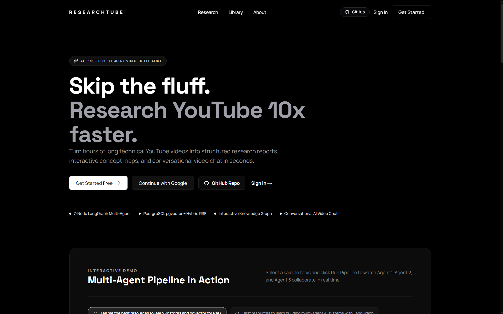 | 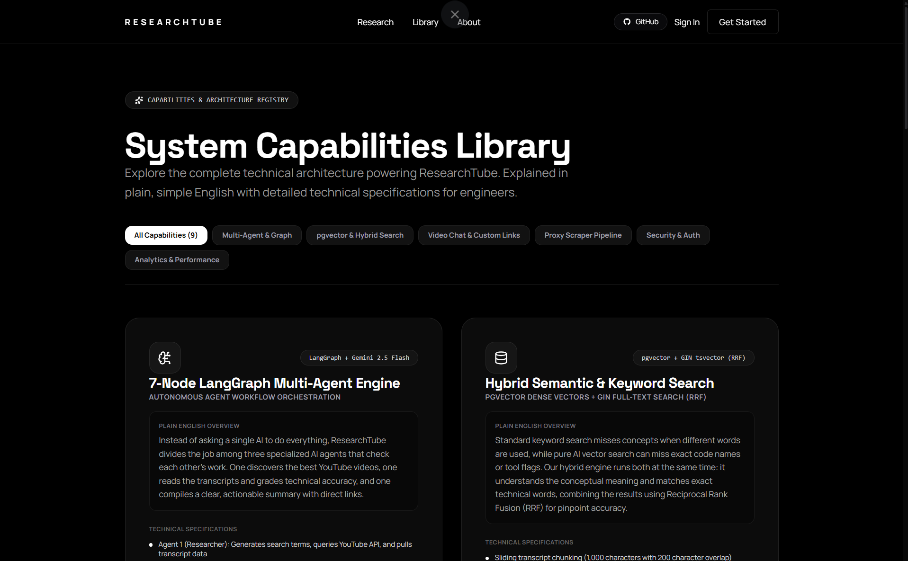 |

| Sign In | Create Account |
| :---: | :---: |
| 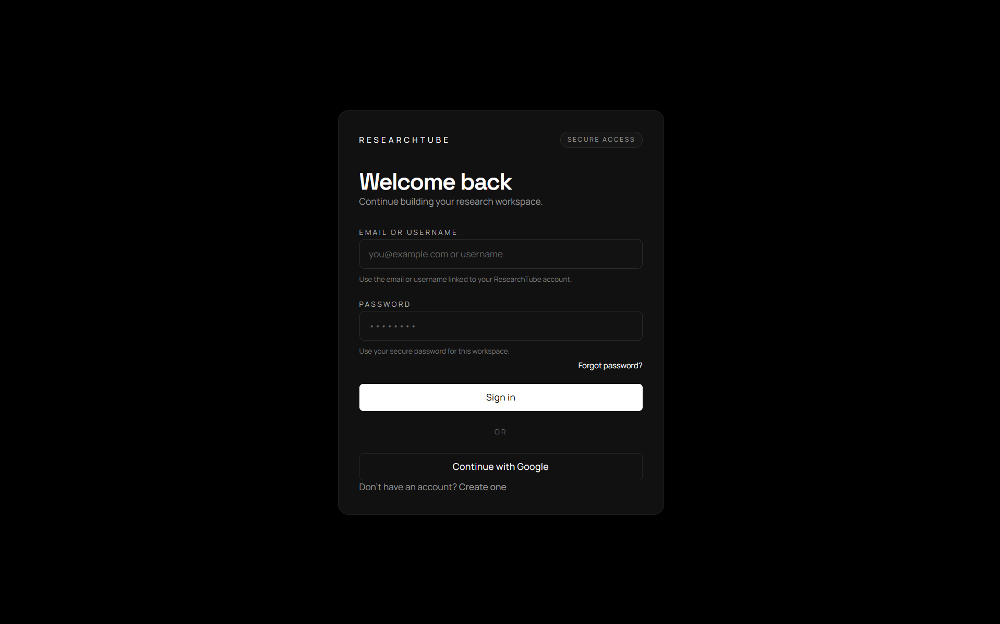 | 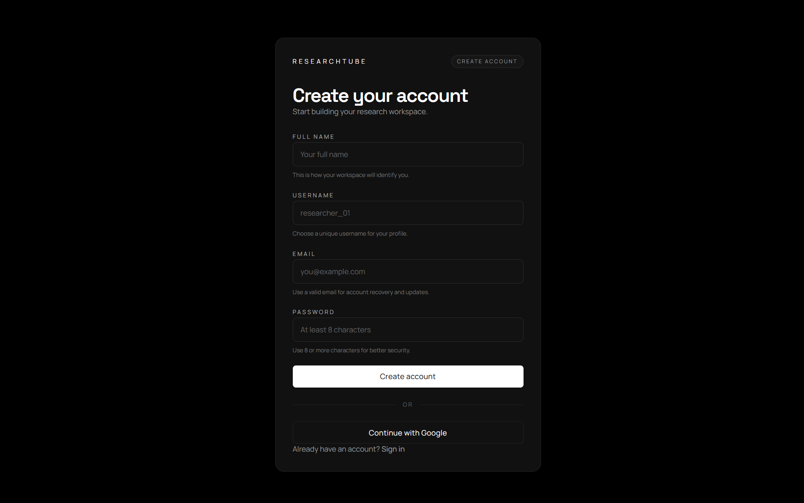 |

| New Research Workspace | Research Report |
| :---: | :---: |
| 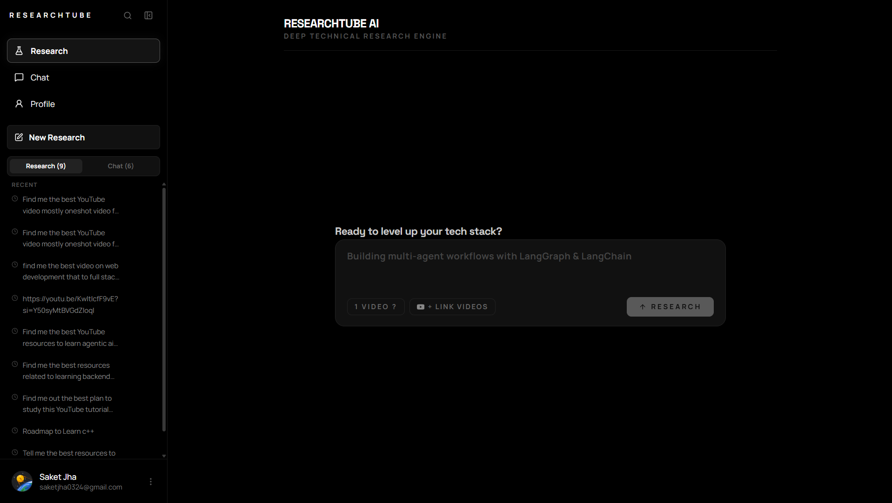 | 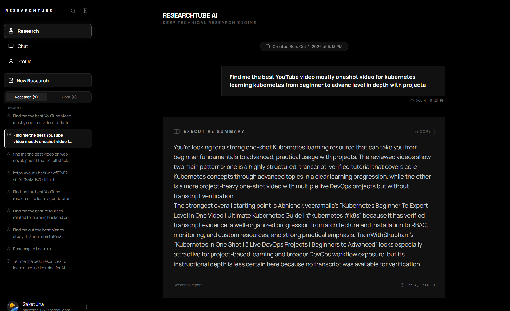 |

| Ranked Resources & Knowledge Graph | Profile & Analytics |
| :---: | :---: |
| 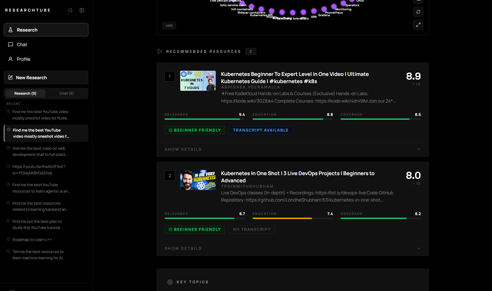 | 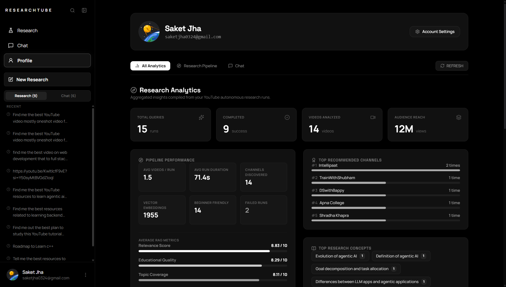 |

| Chat Workspace | Video Scope Selector | Active Chat Thread |
| :---: | :---: | :---: |
| 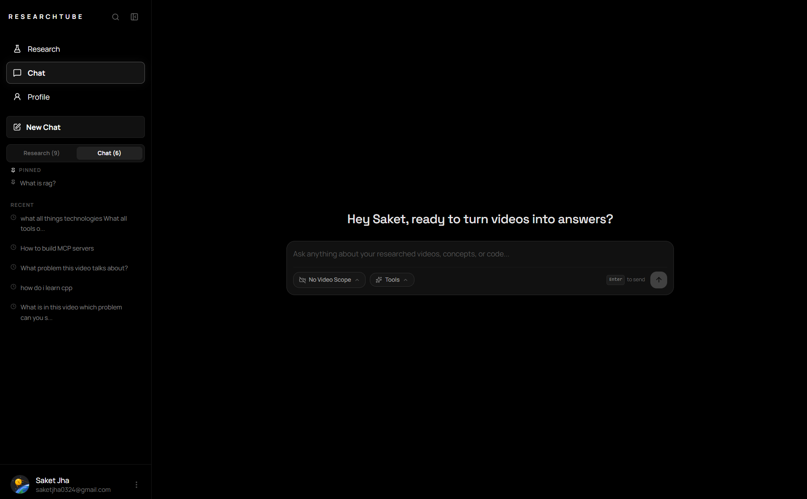 | 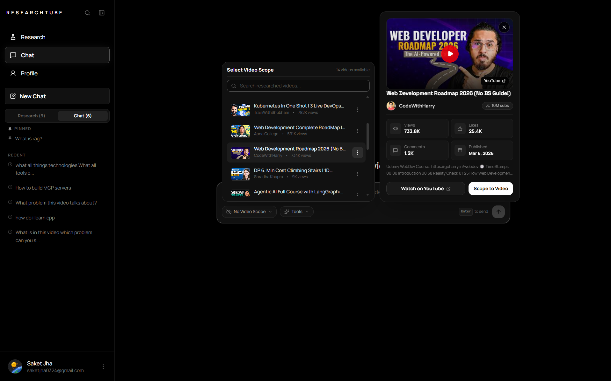 | 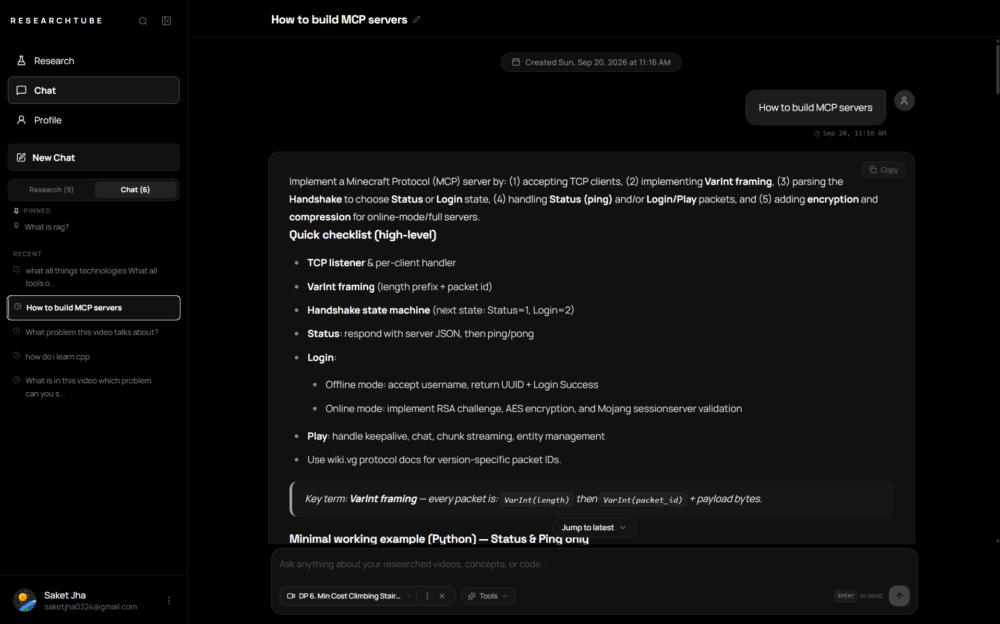 |
